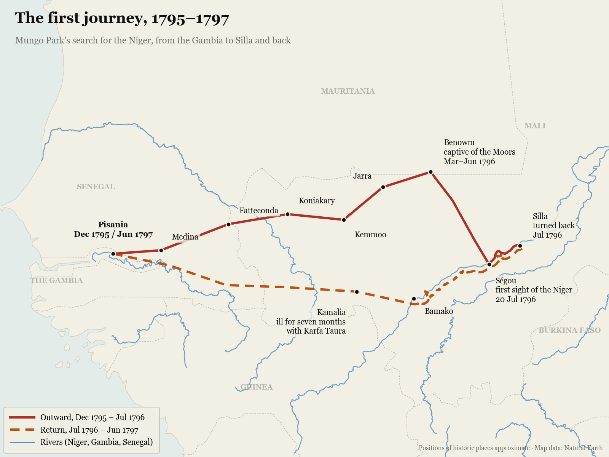
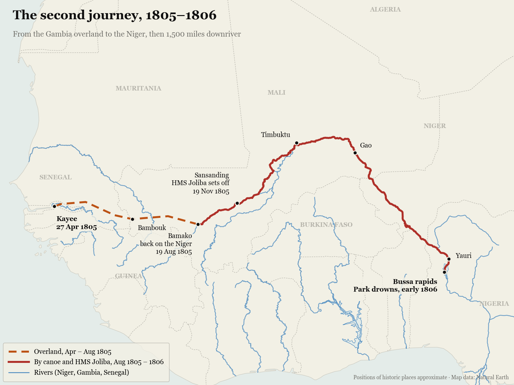

Two men, one river. Mungo Park wants to explore the Niger and become immortal. Ned Rise, a crook from the London gutter, wants just one thing: to rise. T.C. Boyle lets their paths cross in Africa: wild, cruel and hilariously funny. That is *Water Music*.

Most of the time the story had me hooked. Here and there, though, I missed some pace. I wanted to hear more about Africa and the Niger, and less of the inner dialogue of Mungo's wife. It's not uninteresting, but given how little reading time I have, I'd have liked those parts written a bit more efficiently.

What fascinated me most was the dedication and the ability to suffer that people had back then. Today everyone lives like a king, and I think most of us don't really know what suffering means. Even if you're into the outdoors and travel through Norway, modern equipment and clothing make even the hard days feel like a walk in the park.

I also wondered how safe it is today to travel along Mungo's route. I might watch a documentary about it.

Because the trips fascinated me from a sports perspective too, I asked Claude for maps of Mungo's first and second journeys, so I could then look up images of the places he went.

## The first journey, 1795–1797

## The second journey, 1805–1806

Several of the 18th-century places no longer exist, so their positions are approximate. The rivers and the route along the Niger come from [Natural Earth](https://www.naturalearthdata.com/). The script that draws the maps is `scripts/build_mungo_park_maps.py`.
